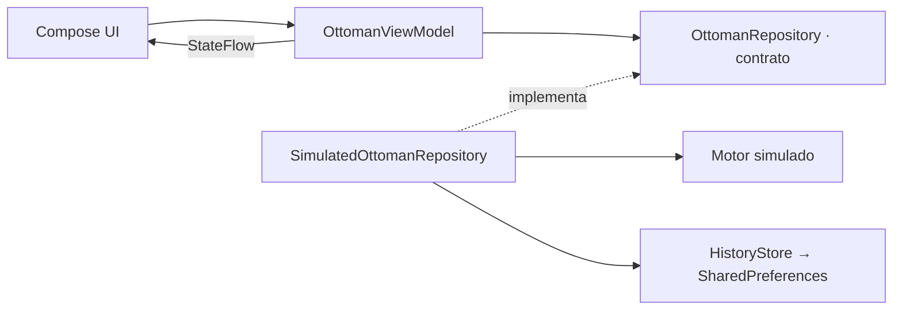

# Decisiones técnicas y arquitectura

## Alcance

Ottoman es una demo académica offline para que un operador supervise una misión de acompañamiento. Se implementó Android nativo en Kotlin y Jetpack Compose, sin integración con hardware, red o servicios externos.

## Referencia a Bookie

Se revisaron el `README.md`, `docs/architecture.md`, `androidApp/`, `shared/` y el catálogo Gradle del repositorio [bookie-frontend](https://github.com/tomasbondUade/bookie-frontend). Se adoptaron sus límites entre presentación, dominio y datos, y su regla de dependencias hacia contratos de dominio. No se copiaron funcionalidades de libros, nombres, pantallas ni la arquitectura multiplataforma.

## Flujo de dependencias

- **Presentación:** `presentation/ui/OttomanApp.kt` muestra estados, toma acciones y nunca accede al simulador o al almacenamiento.
- **ViewModel:** `presentation/OttomanViewModel.kt` conecta eventos de UI con el repositorio y publica su `StateFlow`.
- **Dominio:** `domain/Models.kt` y `domain/OttomanRepository.kt` contienen estados, contratos y comandos sin dependencias Android.
- **Datos:** `data/SimulatedOttomanRepository.kt` implementa el contrato, las reglas de transición y los escenarios deterministas. `HistoryStore` separa el almacenamiento; `SharedPreferencesHistoryStore` conserva localmente el historial.
- **Composición:** `MainActivity` construye el ViewModel Android; un único ViewModel de Activity mantiene un simulador durante navegación y rotación.

## Decisiones y límites

1. **Solo Android:** la consigna pide un APK. KMP/iOS agregaría trabajo sin cubrir una exigencia adicional.
2. **Simulación en memoria:** reproduce telemetría, progreso, batería, órdenes, respuestas, desconexión, obstáculo y separación del visitante sin afirmar capacidades reales del robot.
3. **StateFlow:** estado inmutable observable por Compose. El ticker avanza la simulación una vez por segundo y se cancela con el ciclo de vida del ViewModel.
4. **SharedPreferences para historial:** `HistoryStore` permite probar el repositorio sin Android, y `SharedPreferencesHistoryStore` persiste la lista local de eventos sin consultas relacionales ni sincronización. Para producción o volúmenes mayores convendría Room; para el alcance offline del TP, las preferencias privadas ofrecen persistencia simple sin sumar infraestructura.
5. **ACK separado de ejecución:** `CONFIRMED` significa aceptación del comando por el simulador. El estado de la misión se observa por telemetría.
6. **Seguridad:** acciones destructivas piden confirmación; el modo demo explica que una detención de software no es parada de emergencia física. Si la conectividad cae, se congela la última telemetría y se deshabilitan órdenes.
7. **Mapa y métricas ficticios:** el campus, recorrido, movimiento y persona acompañada son datos demostrativos; no se capturan imágenes, audio ni identidad.

## Máquina de estados

`IDLE → PREPARING → RUNNING → COMPLETED`; `RUNNING ↔ PAUSED`; `RUNNING → BLOCKED → PAUSED/RUNNING` luego de resolver el obstáculo; `RUNNING/PAUSED → RETURNING → IDLE`; y transiciones a `CANCELLED` o `STOPPED` por solicitud confirmada. Batería mínima de inicio propuesta: 25%; umbral crítico de retorno: 10%. Ninguno de esos valores es una especificación de Unitree.

Los comandos pasan por `PENDING` y terminan en `CONFIRMED`, `REJECTED` o `NO_RESPONSE`. Una orden rechazada o sin respuesta no cambia el estado de la misión.
